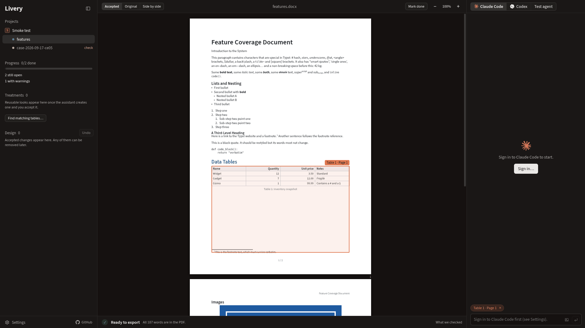
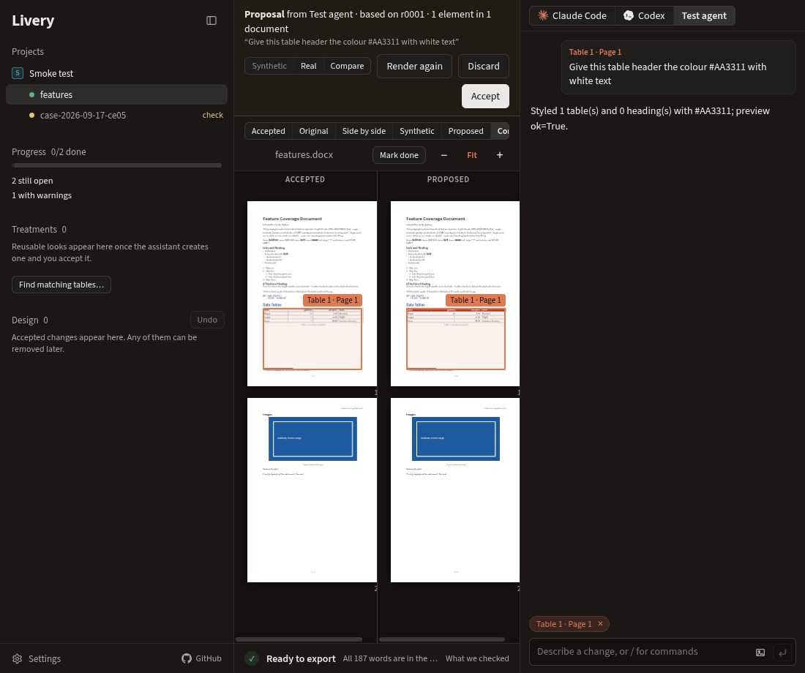
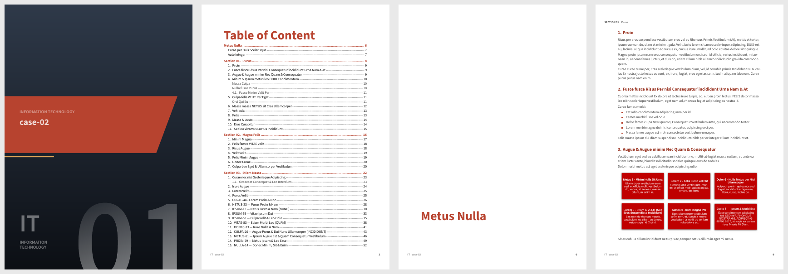

# Livery

[](https://github.com/eddev00/livery/actions/workflows/ci.yml)
[](LICENSE)

A Linux desktop app for restyling batches of Word documents with an AI design assistant, where
**the assistant never sees your documents** and **no PDF leaves the app unless every word of the
source is in it**.

Import `.docx` files, click a heading, paragraph or table in the preview, describe the change in
the chat ("make every table header like this one, darker"), review the proposal against your real
content, accept it, and export the whole batch as PDF.



## How it works

```
             ┌──────────── your machine ─────────────────────────────────────────────┐
  .docx ──▶  │ pandoc + Lua filter ──▶ content.typ ──┐                               │
             │                                       ├─ typst ──▶ PDF ──▶ checks ──▶ │ ──▶ export
             │ design (theme, treatments, overrides) ┘                  ▲            │
             │      ▲                                                   │            │
             │      │ proposal          source text vs Typst vs PDF ────┘            │
             │ ┌────┴──────────────── Bubblewrap sandbox, no network* ─────────┐     │
             │ │ Claude Code / Codex  ◀── lorem-ipsum twins of the documents   │     │
             │ └────────────────────────────────────────────────────────────────┘     │
             └───────────────────────────────────────────────────────────────────────┘
                                            * except the provider's API, through a proxy
```

- **Content is fixed, design is not.** Each document is converted once into plain Typst markup.
  Everything visual lives in a separate design layer (theme, reusable *treatments*, per-element
  *overrides*, custom Typst rules), so the assistant can only change how things look.
- **Every PDF is checked word by word.** The engine compares the Word source text with the
  generated Typst and with the text layer of a verification render of the final PDF. A missing or
  added word fails the document; a failed document cannot be exported.
- **The assistant works on lorem-ipsum twins.** Before anything reaches the agent, each document
  is cloned with every word, number and image replaced, keeping structure, styles, tables and
  lengths. A second check confirms no original word survives. The agent runs in a Bubblewrap
  sandbox that sees only those twins and the design files.
- **Proposals, not edits.** Each agent turn becomes a proposal: previewed first on the twins, then
  rendered with the real documents on your machine, shown side by side with the accepted design,
  and only then accepted or discarded. Accepted changes stay individually removable.



The default template, rendered from one of the test documents (a lorem-ipsum twin):



## Design decisions

**Why Typst instead of editing the Word file?** Restyling inside `.docx` means fighting Word's
style inheritance, direct formatting and layout differences between renderers. Converting once to
Typst gives a small, deterministic markup that a template can style completely, compiles in
milliseconds, and produces the same PDF on every machine (fonts are bundled; system fonts are
ignored in the app).

**Why verify the PDF text instead of trusting the pipeline?** pandoc, the Lua filter, the
template and the agent's custom rules can all drop content silently: a style that hides an
element, a table cell that overflows, an image caption swallowed by a filter. Comparing the
source text against the PDF text layer catches all of them at the only point that matters. The
hard part is that `pdftotext` is noisy: it glues words in overflowing cells, splits hyphenated
words, reorders table text and even merges identical overlapping letters. `livery/verify.py`
reconciles those artefacts explicitly and reports them, so the check stays strict without
false alarms.

**Why lorem-ipsum twins instead of redaction?** Redaction leaks structure in uneven ways and
breaks layout. A twin keeps every word's length, case and punctuation, every table shape and
every style, so a design that works on the twin works on the real document, while the text
itself is meaningless. Twins are verified to contain no original word before they are used.

**Why a sandbox around a trusted agent?** The privacy promise should not depend on the agent
behaving. Bubblewrap gives it a read-only system, an otherwise empty home and only `/work`, a
cleared environment, and no host network: its one way out is a proxy that connects only to its
provider's hosts. Its design changes are validated against a closed schema before they become a
proposal, and renders run in a second sandbox with no network at all.

## Repository

```
app/        Electron + React + TypeScript (Vite): the three-pane workspace
engine/     the Python engine (conversion, integrity checks, lorem twins) and its desktop
            layer in engine/livery/desktop/: local API, projects, design revisions,
            selection maps, agent adapters, sandboxes
packaging/  AppImage build (engine and tools built in an Ubuntu 22.04 container) and the
            clean-system test
docs/       setup, the designer's workflow, privacy and isolation, architecture
```

- **Install and set up:** [docs/SETUP.md](docs/SETUP.md)
- **Use it:** [docs/WORKFLOW.md](docs/WORKFLOW.md)
- **What stays private, and how:** [docs/PRIVACY.md](docs/PRIVACY.md)
- **How it is built:** [docs/ARCHITECTURE.md](docs/ARCHITECTURE.md)
- **How documents are read in (per-project mapping rules):** [docs/MAPPING.md](docs/MAPPING.md)
- **The engine on its own (CLI and web UI):** [engine/README.md](engine/README.md)

## Build the AppImage

Needs Docker and Node.js 20 or newer.

```
packaging/build-appimage.sh          # -> dist/Livery-1.0.0-x86_64.AppImage
packaging/test-clean.sh              # installs it in a fresh ubuntu:24.04 container and runs the
                                     # end-to-end smoke test (import, verify, select, agent loop
                                     # with the test agent in the sandbox, accept, export)
```

## Develop

```
cd engine && uv sync                 # Python engine, tests need pandoc, typst, poppler, bwrap
uv run pytest                        # engine tests + tests/desktop (fake agent in the real sandbox)
uv run python scripts/batch_pilot.py # the 50-document batch run

cd app && npm install
npm run dev                          # builds and starts Electron with the engine from ../engine
```

`LIVERY_HOME` moves the data folder (default `~/.local/share/livery`).
`LIVERY_ENABLE_FAKE_AGENT=1` adds the deterministic test agent next to Claude Code and Codex.
`LIVERY_SMOKE=<folder>` with `LIVERY_SMOKE_DOCS=a.docx:b.docx` runs the app's built-in
end-to-end smoke test and exits (add `LIVERY_SMOKE_AGENT=fake` for the agent loop). The
screenshots in this README come from that run.

## License

[MIT](LICENSE). The bundled Source Sans 3 fonts are under the SIL Open Font License 1.1.
