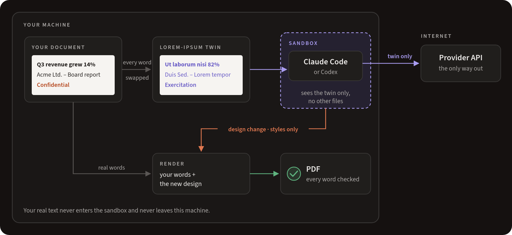
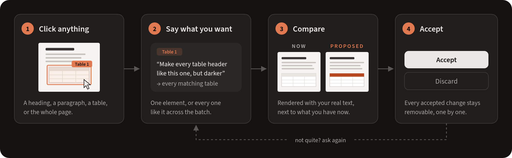
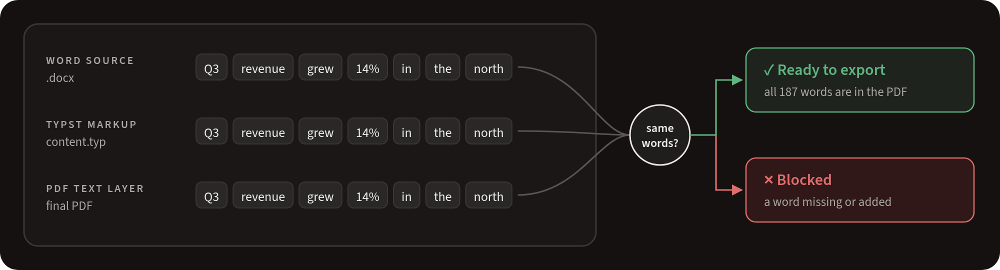

# Livery

[](https://github.com/eddev00/livery/actions/workflows/ci.yml)
[](LICENSE)

A Linux desktop app for restyling batches of Word documents with an AI design assistant, where
**the assistant never sees your documents** and **no PDF leaves the app unless every word of the
source is in it**. Windows and macOS releases are coming soon.

Import `.docx` files, click a heading, paragraph or table in the preview, describe the change in
the chat ("make every table header like this one, darker"), review the proposal against your real
content, accept it, and export the whole batch as PDF.


## Why Livery

- **Use coding agents on confidential documents without leaking them.** Claude Code or Codex
  designs your documents, but only ever sees lorem-ipsum copies, inside a sandbox with no network
  except its own API. Your real text never leaves your machine.
- **Design freedom Word doesn't give you.** No style inheritance, no direct-formatting fights, no
  layout that shifts between machines. Point at anything, say what you want in plain words, and
  apply it to one element or every similar one across the whole batch. Anything Typst can draw,
  the assistant can build.
- **Nothing gets lost.** Every exported PDF is checked word by word against the original.

## How it works

**1. Your documents stay home, the agent gets a stand-in.**



**2. Every change is a proposal you can compare, accept or undo.**



**3. No PDF ships with a missing word.**



In short: content and design are separate layers. Content is converted once and never touched;
the agent can only change how it looks.


## Design decisions

**Why Typst instead of editing the Word file?** Restyling inside `.docx` means fighting Word's
style inheritance, direct formatting and layout differences between renderers. Converting once to
Typst gives a small, deterministic markup that a template can style completely, compiles in
milliseconds, and produces the same PDF on every machine (fonts are bundled; system fonts are
ignored in the app).

**Why verify the PDF text instead of trusting the pipeline?** pandoc, the Lua filter, the
template and the agent's custom rules can all drop content silently: a style that hides an
element, a table cell that overflows, an image caption swallowed by a filter. Comparing the
source text against the PDF text layer catches all of them at the only point that matters. The
hard part is that `pdftotext` is noisy: it glues words in overflowing cells, splits hyphenated
words, reorders table text and even merges identical overlapping letters. `livery/verify.py`
reconciles those artefacts explicitly and reports them, so the check stays strict without
false alarms.

**Why lorem-ipsum twins instead of redaction?** Redaction leaks structure in uneven ways and
breaks layout. A twin keeps every word's length, case and punctuation, every table shape and
every style, so a design that works on the twin works on the real document, while the text
itself is meaningless. Twins are verified to contain no original word before they are used.

**Why a sandbox around a trusted agent?** The privacy promise should not depend on the agent
behaving. Bubblewrap gives it a read-only system, an otherwise empty home and only `/work`, a
cleared environment, and no host network: its one way out is a proxy that connects only to its
provider's hosts. Its design changes are validated against a closed schema before they become a
proposal, and renders run in a second sandbox with no network at all.

## Repository

```
app/        Electron + React + TypeScript (Vite): the three-pane workspace
engine/     the Python engine (conversion, integrity checks, lorem twins) and its desktop
            layer in engine/livery/desktop/: local API, projects, design revisions,
            selection maps, agent adapters, sandboxes
packaging/  AppImage build (engine and tools built in an Ubuntu 22.04 container) and the
            clean-system test
docs/       setup, the designer's workflow, privacy and isolation, architecture
```

- **Install and set up:** [docs/SETUP.md](docs/SETUP.md)
- **Use it:** [docs/WORKFLOW.md](docs/WORKFLOW.md)
- **What stays private, and how:** [docs/PRIVACY.md](docs/PRIVACY.md)
- **How it is built:** [docs/ARCHITECTURE.md](docs/ARCHITECTURE.md)
- **How documents are read in (per-project mapping rules):** [docs/MAPPING.md](docs/MAPPING.md)
- **The engine on its own (CLI and web UI):** [engine/README.md](engine/README.md)

## Build the AppImage

Needs Docker and Node.js 20 or newer.

```
packaging/build-appimage.sh          # -> dist/Livery-0.1.0-x86_64.AppImage
packaging/test-clean.sh              # installs it in a fresh ubuntu:24.04 container and runs the
                                     # end-to-end smoke test (import, verify, select, agent loop
                                     # with the test agent in the sandbox, accept, export)
```

## Develop

```
cd engine && uv sync                 # Python engine, tests need pandoc, typst, poppler, bwrap
uv run pytest                        # engine tests + tests/desktop (fake agent in the real sandbox)
uv run python scripts/batch_pilot.py # the 50-document batch run

cd app && npm install
npm run dev                          # builds and starts Electron with the engine from ../engine
```

`LIVERY_HOME` moves the data folder (default `~/.local/share/livery`).
`LIVERY_ENABLE_FAKE_AGENT=1` adds the deterministic test agent next to Claude Code and Codex.
`LIVERY_SMOKE=<folder>` with `LIVERY_SMOKE_DOCS=a.docx:b.docx` runs the app's built-in
end-to-end smoke test and exits (add `LIVERY_SMOKE_AGENT=fake` for the agent loop, and
`LIVERY_SMOKE_SIZE=1920x1080` to set the screenshot size, whatever your monitor). The
screenshots in this README come from that run.

## Contact

Questions, bug reports and feature requests: [GitHub Issues](https://github.com/eddev00/livery/issues),
or email [eddevjo@gmail.com](mailto:eddevjo@gmail.com).

## License

Copyright (C) 2026 eddev00

Livery is free software: you can redistribute it and/or modify it under the terms of the
[GNU Affero General Public License](LICENSE) as published by the Free Software Foundation,
either version 3 of the License, or (at your option) any later version. It is distributed
without any warranty; see the license for details.

The bundled Source Sans 3 fonts (`app/src/fonts`, `engine/template/assets/fonts`,
`engine/livery/desktop/neutral/assets/fonts`) are by Adobe under the SIL Open Font
License 1.1, included next to them as `SourceSans3-LICENSE.md`.
